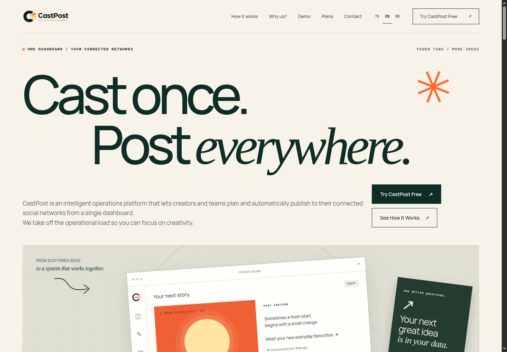
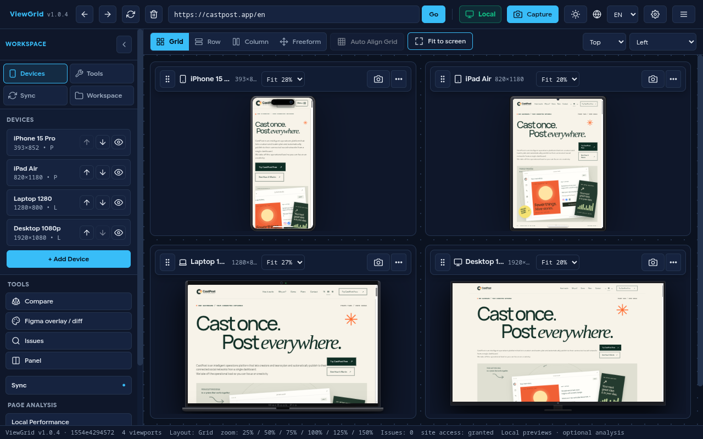
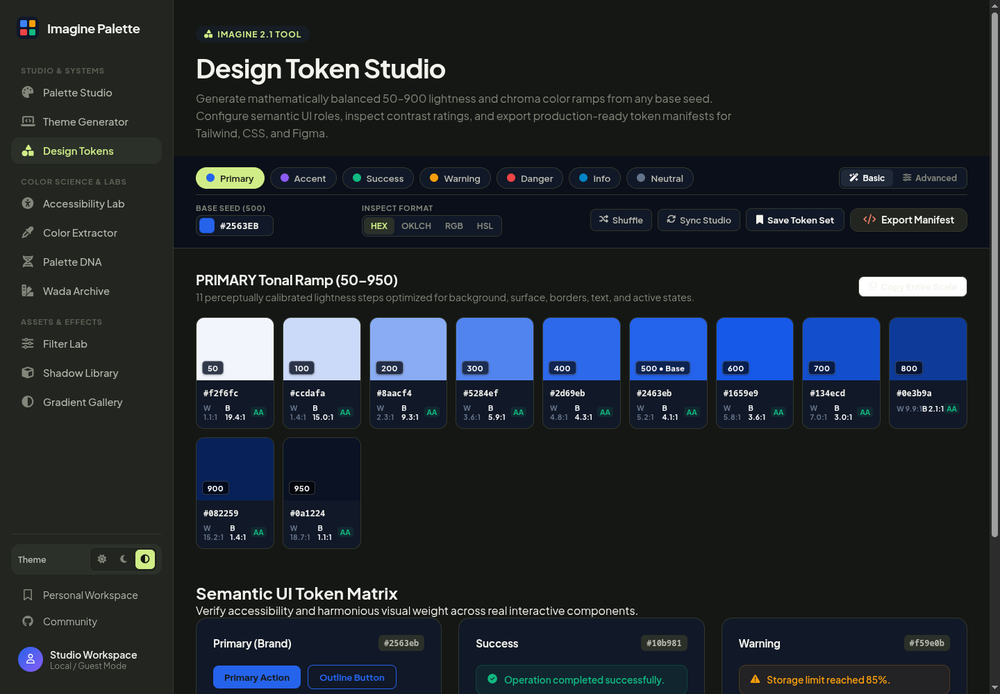
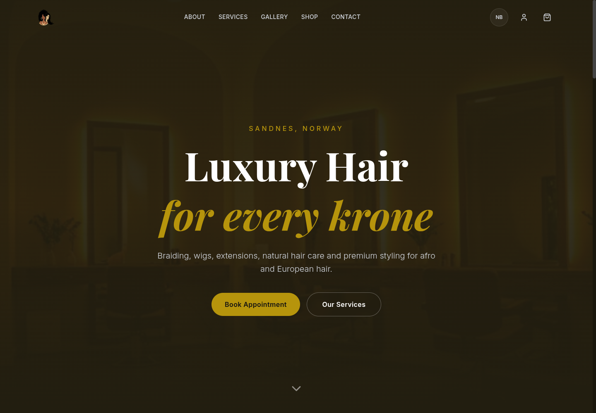
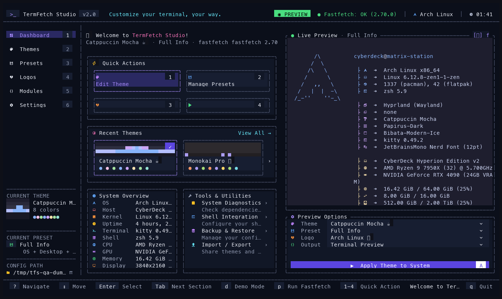

  

<h1 align="center">Sinan Sarikaya</h1>

<strong>Founder & Full Stack Software Engineer</strong> · Stavanger, Norway

Web applications, SaaS products and developer tools — from interface to infrastructure.

  <a href="https://sinansarikaya.dev"><strong>Portfolio & Engineering Notes</strong></a> ·
  <a href="https://www.linkedin.com/in/sinansarykaya/">LinkedIn</a> ·
  <a href="mailto:me@sinansarikaya.dev">Email</a>

I build and run software through **[SARIKAYA IT-FIRMA](https://sinansarikaya.dev/business)**, my Norwegian sole proprietorship. I work across frontend, backend, databases and deployment, with a background in computer repair, networks and Linux administration.

**Open to full-stack software engineering roles in Norway and with remote teams.**

## What I'm working on

- **CastPost:** developing a social media management SaaS with Next.js, TypeScript, PostgreSQL and Prisma.
- **TermFetch Studio:** rewriting the published Linux tool in Rust and Ratatui, with live configuration previews. Windows, macOS, broader Linux support and package-manager distribution are planned.
- **ViewGrid and ImaginePalette:** building tools that help developers test layouts and work with color and CSS.

## Selected projects

### [CastPost](https://castpost.app) · In development

A social media management workspace for planning and publishing content to connected accounts. Initial development focuses on Instagram, Facebook and Threads. I handle the product, frontend, backend and deployment.

**Stack:** Next.js, TypeScript, PostgreSQL, Prisma 
[Product website](https://castpost.app) · Source currently private

### [ViewGrid](https://viewgrid.sinansarikaya.dev) · Published for Chrome and Firefox

A browser extension that displays phone, tablet and desktop layouts side by side. Scrolling, clicks and form input stay synchronized across viewports. Includes local SEO and accessibility checks.

**Stack:** TypeScript, Vite, WebExtensions, Playwright 
[Source](https://github.com/sinansarikaya/viewgrid) · [Chrome Web Store](https://chromewebstore.google.com/detail/viewgrid-%E2%80%94-responsive-vie/hmlhooeamfmhdeichnghcklahfgimgef) · [Firefox Add-ons](https://addons.mozilla.org/en-US/firefox/addon/viewgrid-responsive-viewer/)

### [ImaginePalette](https://imaginepalette.com) · Live

A collection of tools for color palettes and CSS, developed from my earlier JavaScript Colors Palette project. It includes palette generation, design tokens, contrast checks, gradients, shadows and filter previews.

**Stack:** JavaScript, SCSS, Vite 
[Live application](https://imaginepalette.com) · Source currently private

### [Afro Hairstyling](https://afrohairstyling.com) · Live

A multilingual salon website and e-commerce application for Afro Hairstyling in Sandnes. I developed service and gallery pages, product shopping, order tracking and links to Timma appointment booking.

**Stack:** Next.js, TypeScript, Django, Django REST Framework 
[Live website](https://afrohairstyling.com) · Source private

### [TermFetch Studio](https://github.com/sinansarikaya/termfetch-studio) · Rust rewrite in development

An interactive tool for customizing fastfetch and terminal themes. The published version runs on Linux with Bash. I'm rebuilding the interface in Rust and Ratatui with themes, presets, logos and live previews.

*Development preview of the Rust rewrite with sample data.* Windows, macOS, broader Linux support and package-manager distribution are development goals.

**Stack:** Bash, fastfetch, Rust, Ratatui 
[Published Linux source](https://github.com/sinansarikaya/termfetch-studio)

## Experience and infrastructure

During my **February–September 2026 internship at [Outfront AS](https://outfront.no/om-oss/)**, I contributed to completing **Logic Living**, a platform built with Next.js, Spring Boot and PostgreSQL, including WordPress/WooCommerce and Cloudflare Stream integrations.

I also set up a new server, migrated websites and handled server administration, security measures, troubleshooting and maintenance. My own projects involve Linux servers, Docker deployments and ongoing application operations.

## Technologies

| Area | Tools I use |
| --- | --- |
| Frontend | TypeScript, JavaScript, React, Next.js, HTML, CSS, PostCSS |
| Backend | Java, Spring Boot, Python, Django, NestJS, REST APIs |
| Data | PostgreSQL, Prisma, MySQL |
| Infrastructure | Linux, Docker, GitHub Actions, Cloudflare, Dokploy |
| Developer tools | Rust, Ratatui, WebExtensions, Vite, Playwright |

## Get in touch

[**sinansarikaya.dev**](https://sinansarikaya.dev) — projects, technical background and engineering notes. 
[**me@sinansarikaya.dev**](mailto:me@sinansarikaya.dev) · [LinkedIn](https://www.linkedin.com/in/sinansarykaya/)

Portfolio available in <a href="https://sinansarikaya.dev">English</a>, <a href="https://sinansarikaya.dev/tr">Türkçe</a> and <a href="https://sinansarikaya.dev/nb">Norsk</a>.
